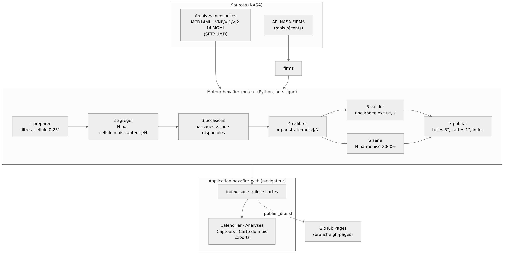

# 0. Résumé

HEXAFIRE répond au défi *Harmonization of MODIS and VIIRS Hot Spots*. Il se compose de deux éléments.

1. **Un moteur d'harmonisation** (Python, hors ligne). À partir des archives mensuelles de points chauds de la NASA,
   il produit une série mensuelle **cohérente de novembre 2000 à aujourd'hui** pour chaque cellule de 0,25° du globe,
   exprimée en équivalent MODIS. VIIRS est converti en équivalent MODIS par un facteur appris quand les deux
   instruments observaient ensemble (2012–2020). Le facteur est estimé par **région × mois de l'année × jour/nuit**,
   à **nombre de passages égal**. La conversion est validée par un test « une année exclue ».
2. **Une application web statique** (HTML/JavaScript, sans serveur), inspirée de NASA POWER. Pour une zone tracée
   n'importe où dans le monde, elle affiche le **calendrier années × mois** des points chauds, l'**écart à la normale
   2003–2020**, des analyses saisonnières, la preuve de l'harmonisation et une carte mensuelle, avec exports CSV, JSON,
   PNG et SVG.

| Élément | Où | Document détaillé |
|---|---|---|
| Moteur | `hexafire_moteur/` | ce dossier (sections 4 à 6), `GUIDE_EXECUTION.md` |
| Application | `hexafire_web/` | ce dossier (section 7), `FICHE_TECHNIQUE.pdf`, `docs/GUIDE_UTILISATEUR.pdf` |
| Données sources | — | `DATA_SOURCES.md` |
| Document de recherche | `HEXAFIRE_v2_fusion.pdf` | état de l'art, choix de méthode |

# 1. Problème traité

MODIS (satellites Terra et Aqua, depuis 2000) a des pixels de 1 km. VIIRS (Suomi NPP depuis 2012, NOAA-20 depuis
2018, NOAA-21 depuis 2023) a des pixels de 375 m et détecte beaucoup plus de petits feux, de jour comme de nuit. Une
série qui passe de MODIS à VIIRS présente donc une **fausse hausse**. Sur nos premières données, le facteur atteint
environ **×5 de jour et ×15 de nuit** à nombre de passages égal. Les deux capteurs ne passent pas non plus le même
nombre de fois au-dessus d'un point : la fauchée et l'orbite diffèrent, et il y a des pannes. Le défi demande une
série harmonisée et une application de type calendrier des points chauds.

**Choix structurants** (décidés avec l'équipe) :

- **couverture mondiale** ;
- **unité de calcul MODIS** : la série de référence est mesurée, et VIIRS est converti ;
- affichage possible en équivalent VIIRS ;
- **bascule vers VIIRS en janvier 2021** ;
- validation sur le critère du défi : le **verdict** bas / normal / haut d'un mois doit être le même avec VIIRS converti qu'avec MODIS.

# 2. Architecture générale

{width=100%}

Principes :

- **Aucun serveur en production.** Le moteur tourne hors ligne et écrit des fichiers JSON statiques ; l'application ne fait que les lire.
- **Étapes indépendantes et relançables.** Chaque étape lit les fichiers de l'étape précédente et écrit les siens. Une étape déjà faite n'est pas refaite (par exemple, chaque archive préparée est enregistrée avec son empreinte SHA-256).
- **Stockage creux.** Seules les cellules × mois ayant au moins une détection sont écrites. Une cellule absente pour un mois observé vaut 0.
- **Traçabilité.** Les journaux, les statuts de chaque mois (mesuré, converti, provisoire, couverture partielle, non observé) et la provenance figurent dans les exports.

## 2.1 Arborescence

```
Hackathon_NASA_2026/
├── README.md                 présentation (anglais)
├── DATA_SOURCES.md           provenance et conditions d'utilisation des données
├── telecharger_archives.sh   téléchargement des archives (lftp, SFTP UMD)
├── publier_site.sh           mise en ligne (GitHub Pages, branche gh-pages)
├── HEXAFIRE_v2_fusion.tex    document de recherche
├── hexafire_moteur/          moteur
│   ├── config.toml           chemins, grille, filtres, périodes
│   ├── requirements.txt      dépendances Python
│   ├── pytest.ini            configuration des tests
│   ├── GUIDE_EXECUTION.md    exécution pas à pas
│   ├── hexafire/             package (12 modules, environ 1 700 lignes)
│   └── tests/                14 tests automatiques
├── hexafire_web/             application
│   ├── index.html, css/, js/ (9 modules, environ 1 200 lignes)
│   ├── donnees/              fichiers publiés par le moteur (non versionnés)
│   ├── FICHE_TECHNIQUE.pdf   fiche de l'application
│   └── docs/                 guide d'utilisation, dossier technique
├── donnees_brutes/           archives téléchargées (non versionnées, environ 15 Go ; 30 Go avec NOAA)
├── donnees_preparees/        détections filtrées (non versionnées)
├── agregats/                 tables intermédiaires (non versionnées)
└── journaux/                 journaux et résultats de validation (non versionnés)
```

## 2.2 Modules du moteur

| Module | Rôle |
|---|---|
| `config.py` | lecture de `config.toml` (chemins, pas de grille, filtres, périodes) |
| `tables.py` | lecture et écriture des tables (Parquet, sinon CSV compressé), écriture atomique |
| `grille.py` | numérotation des cellules et centres |
| `lecture.py` | reconnaissance des archives, choix de version, lecture au schéma commun |
| `preparation.py` | filtres, rattachement aux cellules, journal SHA-256 |
| `agregation.py` | comptages cellule × mois × capteur × jour/nuit ; comptages mondiaux par jour |
| `occasions.py` | passages par cellule et jours disponibles |
| `harmonisation.py` | estimation de la conversion, relais NOAA, série harmonisée |
| `validation.py` | validation une année exclue, kappa, méthodes de comparaison, intervalle de confiance |
| `publication.py` | fichiers de l'application (index, tuiles, cartes), équivalent VIIRS |
| `firms_recent.py` | mois récents par l'API FIRMS |
| `__main__.py` | interface en ligne de commande `python -m hexafire <commande>` |

# 3. Environnement et dépendances

## 3.1 Moteur

| Élément | Version | Usage |
|---|---|---|
| Python | ≥ 3.11 (utilisé : 3.12) | `tomllib` intégré à partir de 3.11 |
| pandas | ≥ 2.1 | tables, regroupements |
| numpy | ≥ 1.26 | calcul vectorisé (Newton par groupe, médianes) |
| pyarrow | ≥ 14 (facultatif) | format Parquet. Sans lui, repli automatique sur CSV compressé |
| requests | ≥ 2.31 | API FIRMS (module `firms` seulement) |
| pytest | ≥ 7.4 | tests |

Installation :
```bash
cd hexafire_moteur && python3 -m venv .venv && source .venv/bin/activate && pip install -r requirements.txt
```

Outils système :

- **lftp**, pour `telecharger_archives.sh` ;
- **git**, pour le dépôt et la mise en ligne ;
- en option, **cloudflared**, pour un lien de test temporaire.

Ressources :

- environ **15 Go** de disque pour les archives MODIS et S-NPP, environ 30 Go avec NOAA-20 et NOAA-21 ;
- autant pour les données préparées (format Parquet compressé) ;
- la préparation est l'étape la plus longue, car elle lit toutes les archives une fois. Les étapes suivantes travaillent sur des tables agrégées, beaucoup plus petites.

## 3.2 Application

| Élément | Version | Source |
|---|---|---|
| Navigateur récent | modules ES, `fetch`, SVG | — |
| MapLibre GL JS | 4.7.1 | CDN unpkg (carte) |
| Tuiles de fond | — | OpenStreetMap |
| Recherche de lieu | — | OpenStreetMap Nominatim |
| Frontières (facultatif) | 1:110 m | Natural Earth (`donnees/pays.geojson`) |

L'application n'a **aucune étape de compilation** ni dépendance npm. Elle fonctionne derrière n'importe quel serveur
de fichiers statiques : `python3 -m http.server`, GitHub Pages…

# 4. Données d'entrée et préparation

## 4.1 Sources

| Produit | Capteur(s) | Résolution | Période utilisée | Version |
|---|---|---|---|---|
| MCD14ML | Terra, Aqua (MODIS) | 1 km | 2000-11 → 2022-12 / 2023-01 → 2026-08 | 006.03 / 061.03 |
| VNP14IMGML | Suomi NPP (VIIRS) | 375 m | 2012-01 → 2026-07 | C2.04 |
| VJ114IMGML | NOAA-20 (VIIRS) | 375 m | 2018-04 → 2026-07 | C2.04 |
| VJ214IMGML | NOAA-21 (VIIRS) | 375 m | 2023-03 → 2026-07 | C2.04 |
| API FIRMS | MODIS, VIIRS | — | après la fin des archives | NRT / SP |

Les fichiers sont téléchargés par `telecharger_archives.sh`, avec les commandes `modis`, `modis_recent`,
`snpp_calibration`, `snpp`, `noaa20`, `noaa21`. Provenance détaillée : `DATA_SOURCES.md`.

## 4.2 Lecture et schéma commun (`lecture.py`)

Chaque archive est reconnue par son nom (`PRODUIT.AAAAMM.COLLECTION.VERSION.ext.gz`). Si plusieurs versions d'un même
mois existent, la plus récente est retenue. Pour MODIS, la collection 6 est utilisée jusqu'en 2022 et la 6.1 ensuite.
Toutes les détections sont mises au même schéma :

- `capteur`, `famille` ;
- `date`, `hhmm`, `annee`, `mois` ;
- `lat`, `lon` ;
- `frp`, `conf` ;
- `jour_nuit` ;
- `type`, `sample`, `vza`, `pixarea`.

## 4.3 Filtres (`preparation.py`, `config.toml`)

| Règle | Filtre | Raison |
|---|---|---|
| P1 | coordonnées valides | qualité |
| P4 | `type = 0` (feu de végétation présumé) | exclut volcans (1), sources fixes (2), détections en mer (3) |
| P3 | MODIS : confiance ≥ 30 | exclut les détections peu fiables |
| P2 | VIIRS : classe « faible » (`l`) exclue | idem ; on ne filtre jamais sur la seule classe « haute » |
| P7 | rattachement à la cellule de 0,25° contenant la détection | grille commune |

Les effectifs avant et après chaque filtre sont enregistrés dans `journaux/preparation.jsonl`, et un test vérifie
qu'aucune détection ne disparaît sans être comptée. Les détections de l'API FIRMS sont filtrées de la même façon.
Quand la colonne `type` manque (flux NRT), un **masque des sources fixes** la remplace : cellules de 0,05° où MODIS a
signalé des sources de type 1 ou 2 depuis 2022.

## 4.4 Grille

Pas $\Delta = 0{,}25^\circ$ : $n_\text{lon} = 1440$, $n_\text{lat} = 720$. Pour une détection $(\varphi, \lambda)$ :
$$
\text{ligne} = \left\lfloor \frac{90 - \varphi}{\Delta} \right\rfloor,\quad
\text{colonne} = \left\lfloor \frac{\lambda + 180}{\Delta} \right\rfloor,\quad
c = \text{ligne}\cdot n_\text{lon} + \text{colonne}.
$$
Le centre de la cellule $c$ est $\varphi_c = 90 - (\text{ligne} + \tfrac12)\Delta$ et $\lambda_c = -180 +
(\text{colonne} + \tfrac12)\Delta$. La même numérotation sert à $1^\circ$ pour la carte du mois.

# 5. Modèles mathématiques du moteur

**Notations.**

| Symbole | Sens |
|---|---|
| $c$ | cellule |
| $y$ | année |
| $k$ | mois de l'année (1 à 12) |
| $d \in \{J, N\}$ | période, jour ou nuit |
| $s$ | capteur : $T$ (Terra), $A$ (Aqua), $S$ (S-NPP), $P$ (NOAA-20 ou NOAA-21) |
| $M$ | MODIS, c'est-à-dire Terra + Aqua |
| $r$ | strate (bloc régulier de $10^\circ \times 10^\circ$ dans la version actuelle) |

## 5.1 Comptages (`agregation.py`)

$$N_{c,y,k,s,d} = \#\{\text{détections retenues du capteur } s \text{ dans la cellule } c, \text{ le mois } (y,k), \text{ en période } d\}.$$
Le moteur produit aussi le comptage mondial par jour et par capteur $G_{s}(j)$, qui sert à repérer les jours sans
données.

## 5.2 Occasions d'observation (`occasions.py`)

Un nombre de détections ne se compare qu'à nombre de passages égal. Pour un satellite héliosynchrone de fauchée $W$,
d'inclinaison $i$ et effectuant $N_\text{orb}$ orbites par jour, le nombre moyen de passages par jour et par période
au-dessus de la latitude $\varphi$ vaut (méthode analytique dite de niveau 0) :
$$
n_s(\varphi) = \min\!\left(N_\text{orb},\; \frac{N_\text{orb}\, W}{2\pi R \cos\varphi\, |\cos A(\varphi)|}\right),
\qquad \sin A(\varphi) = \min\!\left(1, \frac{|\cos i|}{\cos\varphi}\right),
$$
avec $R = 6371$ km et $A$ l'azimut de la trace au sol.

| Capteur | $W$ (km) | Période orbitale (min) | $i$ |
|---|---|---|---|
| Terra, Aqua | 2 330 | 98,88 / 98,82 | 98,2° |
| S-NPP, NOAA-20, NOAA-21 | 3 060 | 101,44 | 98,7° |

À l'équateur, le rapport des passages VIIRS / MODIS (un satellite chacun) vaut 1,28, cohérent avec la valeur
attendue (1,21 à 1,28).

**Jours disponibles.** Le jour $j$ est disponible pour le capteur $s$ si
$G_s(j) \geq 0{,}1 \times \operatorname{médiane}_{j' \in \text{mois}} G_s(j')$. Une liste externe
`jours_manquants.csv` peut s'y ajouter. On note $D_{s,y,k}$ le nombre de jours disponibles et $L_{y,k}$ le nombre de
jours du mois.

**Occasions et couverture** :
$$
E_{c,y,k,s} = n_s(\varphi_c)\, D_{s,y,k}, \qquad E_{c,y,k,M} = E_{c,y,k,T} + E_{c,y,k,A}, \qquad
\text{couverture}_{s,y,k} = D_{s,y,k} / L_{y,k}.
$$
Pour limiter la mémoire, on stocke seulement $n_s(\varphi_c)$ (table `passages_cellule`) et $D_{s,y,k}$ (table
`jours_disponibles`). $E$ est calculé ligne par ligne au moment de l'usage.

## 5.3 Modèle de conversion VIIRS → MODIS (`harmonisation.py`)

**Modèle génératif.** Pour une cellule-mois-période, on suppose que chaque capteur détecte, par passage, une fraction
$\delta_s$ d'une activité de feu $\Lambda$ inconnue :
$$
N_s \sim \text{Poisson}(\Lambda\, \delta_s\, E_s).
$$

**Conditionnement.** Conditionnellement au total $n = N_S + N_M$, l'activité $\Lambda$ disparaît :
$$
N_S \mid n \sim \text{Binomiale}(n, \pi), \qquad
\operatorname{logit}\pi = \underbrace{\log(\delta_S / \delta_M)}_{\alpha} + \underbrace{\log(E_S / E_M)}_{\text{décalage connu}}.
$$
Le paramètre $\alpha$ mesure l'écart de sensibilité à passages égaux. **Un point chaud S-NPP vaut $e^{-\alpha}$ point
chaud MODIS.** Plus précisément, $N_M / E_M = e^{-\alpha}\, N_S / E_S$. Le modèle n'exige aucune hypothèse sur
l'activité réelle des feux.

**Couples de calibration.** On retient les couples $(c, y, k, d)$ de 2012–2020 qui vérifient :

- $E_M > 0$ et $E_S > 0$ ;
- une couverture d'au moins 80 % pour chacun des deux capteurs ;
- $n \geq 1$.

**Estimation par groupe $g$** (maximum de vraisemblance, Newton vectorisé). En notant $y_i = N_{S,i}$, $n_i$ et
$o_i = \log(E_{S,i}/E_{M,i})$ :
$$
\alpha^{(0)}_g = \operatorname{logit}\!\left(\frac{\sum y_i}{\sum n_i}\right) - \frac{\sum n_i o_i}{\sum n_i},\qquad
\alpha_g \leftarrow \alpha_g + \frac{U_g}{I_g},\quad U_g = \sum_{i\in g} (y_i - n_i\pi_i),\quad I_g = \sum_{i\in g} n_i \pi_i(1-\pi_i).
$$
Le pas est borné à ±5 ; on arrête quand il passe sous $10^{-9}$, ou après 50 itérations.

**Surdispersion** (quasi-binomiale) :
$$
\phi_g = \max\!\left(1,\; \frac{1}{m_g - 1}\sum_{i\in g}\frac{(y_i - n_i\pi_i)^2}{n_i \pi_i (1-\pi_i)}\right), \qquad
\operatorname{se}(\alpha_g) = \sqrt{\phi_g / I_g},
$$
où $m_g$ est le nombre de couples du groupe. Un groupe est **dégénéré** quand $\sum y = 0$, $\sum y = \sum n$ ou
$m_g < 3$. Son erreur type est alors infinie.

**Trois niveaux d'estimation** :

1. $\alpha_{r,k,d}$ : par strate × mois de l'année × période ;
2. $\alpha_{r,d}$ : par strate × période, toutes saisons confondues ;
3. $\alpha_d$ : monde entier, par période. Il remplace $\alpha_{r,d}$ quand ce dernier est dégénéré.

**Stabilisation (DerSimonian–Laird).** Pour chaque $(r, d)$, on estime la variance entre mois $\tau^2_{r,d}$. Avec
$w_k = 1/\operatorname{se}_k^2$ et $\bar\alpha = \sum w_k\alpha_k / \sum w_k$ :
$$
Q = \sum_k w_k(\alpha_k - \bar\alpha)^2,\qquad
\tau^2 = \max\!\left(0,\; \frac{Q - (K-1)}{\sum w_k - \sum w_k^2/\sum w_k}\right).
$$
Puis chaque estimation mensuelle est rapprochée de la valeur de sa strate :
$$
\lambda_{r,k,d} = \frac{\tau^2_{r,d}}{\tau^2_{r,d} + \operatorname{se}^2_{r,k,d}},\qquad
\hat\alpha^\text{stab}_{r,k,d} = \lambda\,\alpha_{r,k,d} + (1-\lambda)\,\alpha_{r,d}.
$$
Un mois mal estimé (erreur type grande ou infinie) prend donc la valeur de sa strate. Un mois bien estimé et
différent des autres garde sa propre valeur.

**Relais NOAA-20 et NOAA-21.** Ces satellites portent le même instrument que S-NPP. Le même estimateur, avec S-NPP
comme référence, donne $\delta_{P,r,k,d}$ (logit $\pi = \delta + \log(E_P/E_S)$) sur les années communes : 2018–2026
pour NOAA-20, 2023–2026 pour NOAA-21. On en déduit :
$$
\alpha_{P} = \alpha_{S} + \delta_{P}\quad\Rightarrow\quad N_M/E_M = e^{-(\alpha_S+\delta_P)}\, N_P/E_P.
$$
Quand $\delta$ n'est pas estimable, on prend sa médiane mondiale par période.

## 5.4 Série harmonisée (`harmonisation.py`)

**Exposition de référence.** Pour que toutes les valeurs soient comparables malgré les pannes :
$$
E^\text{ref}_{c,k} = \operatorname{médiane}_{y \in 2003..2020}\left[\, n_T(\varphi_c)D_{T,y,k} + n_A(\varphi_c)D_{A,y,k} \,\right].
$$

**Période 1 : Terra seul (novembre 2000 – juin 2002).** Le facteur $\gamma$ ramène Terra à Terra + Aqua. Il est estimé
sur 2003–2020 par strate, mois et période, en sommant sur les cellules et les années, avec une correction de 0,5 :
$$
\gamma_{r,k,d} = \log\frac{(N_T + 0{,}5)/E_T}{(N_M + 0{,}5)/E_M},\qquad
\tilde N_{c,y,k,d} = N_{T}\, e^{-\gamma_{r,k,d}}\; \frac{E^\text{ref}_{c,k}}{E_{c,y,k,T}}.
$$

**Période 2 : MODIS mesuré (juillet 2002 – décembre 2020).**
$$
\tilde N = (N_T + N_A)\;\frac{E^\text{ref}_{c,k}}{E_{c,y,k,M}}.
$$

**Période 3 : VIIRS converti (depuis janvier 2021).** Moyenne des plateformes actives, pondérée par leurs occasions.
On n'additionne jamais directement les détections brutes de plusieurs plateformes.
$$
\tilde N = E^\text{ref}_{c,k}\;\frac{\sum_{p} N_{p}\, e^{-\alpha_{p,r,k,d}}}{\sum_{p} E_{c,y,k,p}},\qquad p \in \{\text{S-NPP}, \text{NOAA-20}, \text{NOAA-21}\}.
$$
Un mois postérieur à la bascule sans données VIIRS est calculé comme en période 2 et marqué **provisoire**.

La valeur publiée est $v_{c,y,k} = \tilde N_{c,y,k,J} + \tilde N_{c,y,k,N}$. Le poids d'une détection est le rapport
$\tilde N / N$ de sa cellule-mois-période.

**Statut d'un mois** (selon la couverture de la source utilisée) :

| Couverture | Statut |
|---|---|
| < 30 % | non observé |
| 30 à 80 % | couverture partielle |
| ≥ 80 % | **mesuré** (MODIS Terra + Aqua), **converti** (VIIRS, ou Terra seul en 2000–2002), **provisoire** (MODIS après 2020 en attendant VIIRS) |

**Équivalent VIIRS** (unité d'affichage). C'est l'inverse exact de la conversion, à savoir ce que S-NPP seul aurait
détecté :
$$
w_{c,y,k} = \sum_d \tilde N_{c,y,k,d}\; e^{\alpha_{S,r,k,d}}\; \frac{n_S(\varphi_c)}{n_T(\varphi_c) + n_A(\varphi_c)}.
$$
Un test vérifie que, sur la période VIIRS, $\sum w$ retrouve les détections S-NPP brutes à ±10 %.

## 5.5 Validation (`validation.py`)

**Protocole « une année exclue ».** Pour chaque année $y_0$ où MODIS et S-NPP coexistent :

1. on estime $\hat\alpha^\text{stab}$ **sans** $y_0$ ;
2. on convertit S-NPP de $y_0$ comme si MODIS n'existait plus :
   $X^H = N_S\, e^{-\hat\alpha^\text{stab}}\, E_M/E_S$ ;
3. on agrège par strate × mois ;
4. on compare au vrai $N_M$.

**Méthodes comparées** :

| Méthode | Conversion |
|---|---|
| **H** | HEXAFIRE |
| **M1** | un seul $\alpha_d$ mondial : $X^{M1} = N_S\, e^{-\alpha_d}E_M/E_S$ |
| **M0** | VIIRS brut, seulement ramené aux occasions : $X^{M0} = N_S E_M/E_S$ |

**Verdict.**

- Le taux d'un strate-mois est $\rho = X / E_{r,y,k,M}$.
- Les seuils sont les centiles 10 % et 90 % du taux MODIS du même strate-mois sur 2003–2011 (au moins 6 années) :
  $\rho < q_{10}$ donne « bas », $\rho > q_{90}$ « haut », sinon « normal ».
- On exclut les strates-mois de moins de 10 détections MODIS.

**Critères.** Soit $e = \log(1+X) - \log(1+N_M)$.

| Critère | Définition | Cible |
|---|---|---|
| T1 kappa de Cohen | $\kappa = (p_o - p_e)/(1 - p_e)$ entre verdicts MODIS et verdicts convertis | ≥ 0,5 |
| T1 fausses anomalies | $P(\text{verdict converti} \neq \text{normal} \mid \text{verdict MODIS} = \text{normal})$ | ≤ 0,15 |
| T2 biais | $\operatorname{médiane}(e)$ | $\lvert\cdot\rvert$ < 0,10 |
| T2 erreur | $\operatorname{médiane}(\lvert e\rvert)$ | < 0,25 |
| T4 marche | $\max_{y_0}\lvert \operatorname{moyenne}_{y_0}(e) \rvert$ | < 0,10 |

**Intervalle de confiance.** On tire les années avec remise ($B = 2000$ tirages) et on recalcule
$\kappa_H - \kappa_{M}$. L'intervalle 2,5 %–97,5 % est publié. HEXAFIRE est déclaré supérieur à M1 si l'intervalle
entier est positif.

## 5.6 Publication (`publication.py`)

- **Tuiles** de 5° × 5° (`tuiles/t_<ilat>_<ilon>.json`) : listes parallèles `cellules`, `t` (indice du mois, 0 =
  novembre 2000), `v` (équivalent MODIS), `w` (équivalent VIIRS), `b` (détections brutes de la source du mois).
- **Cartes mensuelles** à 1° (`cartes/m_<t>.json`) : `c`, `v`, `w` et `r` = rapport à la médiane du même mois sur
  2003–2020, calculé seulement si la médiane est ≥ 5 et s'il y a au moins 10 années de référence (sinon −1). Les
  cellules écrites sont celles dont l'activité ou la médiane n'est pas nulle.
- **Index** (`index.json`) : liste des mois (statut, source, couverture), tuiles, unités, validation.

## 5.7 Mois récents (`firms_recent.py`)

Pour les jours postérieurs aux archives (MODIS après août 2026, VIIRS après juillet 2026) :

- requêtes `area/csv/{clé}/{source}/world/{1–5 jours}/{date}`, en produit standard (SP) quand il existe et en temps
  quasi réel (NRT) sinon ;
- reprise possible après interruption ;
- fichiers `<capteur>_<AAAAMM>_api`, ignorés dès que l'archive du même mois arrive.

S-NPP est utilisé jusqu'au 2 novembre 2026, date de fin de ses observations.

# 6. Données intermédiaires

| Table (`agregats/`) | Colonnes principales | Produite par |
|---|---|---|
| `cell_month` | cellule, annee, mois, capteur, jour_nuit, n, frp_somme | agreger |
| `capteur_jour` | capteur, date, jour_nuit, n | agreger |
| `passages_cellule` | cellule, capteur, n_jour | occasions |
| `jours_disponibles` | capteur, annee, mois, jours_mois, jours_disponibles | occasions |
| `conversion_snpp` (+ `_noaa20`, `_noaa21`) | strate, mois, jour_nuit, alpha, se, dispersion, tau2, poids_local, alpha_stab, facteur_viirs_vers_modis | calibrer |
| `conversion_terra` | strate, mois, jour_nuit, nT, nM, eT, eM, gamma | serie |
| `harmonized_cell_month` | cellule, annee, mois, jour_nuit, n_brut, source, E_ref, poids, N_harm | serie |
| `serie_mois` | annee, mois, source_mois, couverture, statut | serie |

`journaux/` contient `preparation.jsonl`, `validation_resultats.csv`, `validation_detail.csv.gz` et `validation_cibles.json`.

# 7. Application web

## 7.1 Organisation

| Module | Rôle |
|---|---|
| `index.html`, `css/style.css` | mise en page façon NASA POWER : carte plein écran, panneau à 4 étapes, résultats à onglets ; thèmes clair et sombre ; affichage téléphone |
| `js/main.js` | état, étapes, indicateurs, unités, couche de la carte, recherche de lieu, thème, lien partagé |
| `js/donnees.js` | index, tuiles et cartes (avec cache) ; zones ; série d'une zone |
| `js/calendrier.js` | statistiques (médianes, classes, refus) et calendrier SVG |
| `js/graphiques.js` | profil saisonnier, saison cumulée, brut / harmonisé, tableaux |
| `js/carte.js` | MapLibre : tracés, couche mensuelle, fond clair ou sombre |
| `js/i18n.js` | textes français / anglais |
| `js/lien.js` | lien partageable (zone, mode, période, unité, langue) |
| `js/export.js` | CSV, cellules × mois, JSON, SVG, PNG, avec provenance et remerciement FIRMS |

## 7.2 Calculs faits dans le navigateur

1. **Zone.**
   - Le navigateur charge les seules tuiles de 5° qui touchent l'emprise de la zone.
   - Une cellule de 0,25° appartient à la zone si son centre y est :
     - cercle : distance du grand cercle inférieure au rayon ;
     - rectangle : test direct sur les bornes ;
     - polygone et pays : lancer de rayon, règle pair-impair, qui gère les trous et les multipolygones.
2. **Série** : $V_t = \sum_{c \in \text{zone}} v_{c,t}$, ou $w_{c,t}$ en équivalent VIIRS.
3. **Normale** : $\operatorname{méd}_k$ = médiane de $V_t$ sur les mois $k$ observés de 2003–2020. Les quartiles sont calculés par interpolation linéaire.
4. **Écart** :
   - rapport $V_t / \operatorname{méd}_k$ ;
   - **refusé** si moins de 10 années de référence, ou si la médiane en équivalent MODIS est < 5 (le même seuil quelle que soit l'unité) ;
   - classes : < 0,5 · 0,5–0,8 · 0,8–1,25 · 1,25–2 · > 2.
5. **Indicateurs** : dernier mois, son écart, mois de pic (médiane maximale), rang de la dernière année complète de la période parmi toutes les années complètes.
6. **Saison cumulée** : elle commence le mois qui suit le mois de médiane minimale. L'enveloppe 10 %–90 % est tirée des saisons complètes 2003–2019.

## 7.3 Volumes (série réelle, novembre 2000 – juin 2024)

| Élément | Volume |
|---|---|
| Tuiles | 893 fichiers, environ 168 Mo au total, 1,6 Mo au maximum |
| Cartes | 284 fichiers, environ 30 Mo |

La recherche d'une zone régionale charge 1 à 10 tuiles. Le volume total reste sous les limites de GitHub Pages
(100 Mo par fichier, environ 1 Go recommandé).

# 8. Résultats (provisoires)

> Ces chiffres seront mis à jour après le passage de la chaîne sur 2012–2020 complet et S-NPP 2021–2026.

**Calibration S-NPP → MODIS** (premier passage, 2012–2013, 328 strates). Valeurs à passages égaux, en médiane des
strates :

| Période | Facteur S-NPP → MODIS | Soit | Intervalle 10 %–90 % des strates |
|---|---|---|---|
| Jour | 0,185 | S-NPP ≈ 5,4 × MODIS | 0,095–0,276 |
| Nuit | 0,064 | S-NPP ≈ 15,6 × MODIS | 0,020–0,113 |

La variation entre régions justifie un facteur par strate plutôt qu'un facteur unique.

**Validation une année exclue** (2012–2015, 7 604 strates-mois) :

| Méthode | kappa | Fausses anomalies | Biais | Erreur | Marche |
|---|---|---|---|---|---|
| **HEXAFIRE** | **0,735** ✓ | **0,098** ✓ | **0,014** ✓ | **0,127** ✓ | **0,051** ✓ |
| M1 facteur global | 0,553 ✓ | 0,239 ✗ | 0,045 ✓ | 0,255 ✗ | 0,123 ✗ |
| M0 VIIRS brut | 0,015 ✗ | 0,925 ✗ | 1,962 ✗ | 1,962 ✗ | 2,028 ✗ |

Intervalle de confiance à 95 % :

- $\kappa_H - \kappa_{M1}$ : [0,168 ; 0,195] ;
- $\kappa_H - \kappa_{M0}$ : [0,711 ; 0,732].

**HEXAFIRE atteint les cinq cibles et fait significativement mieux qu'un facteur unique.**

# 9. Qualité et tests

`pytest -q` lance 14 tests, qui passent sur le PC de développement et dans l'environnement de test.

| Fichier | Ce qui est vérifié |
|---|---|
| `test_preparation.py` | numérotation de la grille aux bords, reconnaissance des archives et choix de version, filtres et conservation des effectifs, passages par jour |
| `test_harmonisation.py` | l'estimateur retrouve un $\alpha$ connu ; facteurs par strate et période ; chaîne `calibrer` sur données simulées (×4 de jour, ×12 de nuit retrouvés) ; continuité de la série à la bascule (±15 %) ; mois sans occasions ; relais NOAA-20 et série multi-plateformes ; équivalent VIIRS = inverse de la conversion (±10 %) |
| `test_validation.py` | kappa ; validation sur données simulées ; publication de l'exemple (format v2, tuiles, cartes) |
| `test_firms_recent.py` | préparation des fichiers de l'API FIRMS (filtres, capteurs, mois) |

L'application a été testée dans Chromium (Playwright) sur le jeu d'exemple :

- les quatre types de zone ;
- les onglets ;
- les unités, les langues, les thèmes ;
- le lien partagé ;
- les exports ;
- l'affichage téléphone.

La carte réelle a été vérifiée dans le navigateur de l'équipe.

# 10. Déploiement

| Usage | Méthode |
|---|---|
| Local | `cd hexafire_web && python3 -m http.server 8000` |
| Test à distance | `cloudflared tunnel --url http://localhost:8000` (lien temporaire) |
| Production | code sur `main` ; `./publier_site.sh` remplace la branche `gh-pages` par l'application et ses données (un seul commit, l'historique ne grossit pas) ; GitHub Pages servant `gh-pages` |

# 11. Limites et perspectives

- **Strates** : blocs réguliers de 10° → à remplacer par les régions GFED × l'occupation du sol (MCD12C1).
- **Occasions** : calcul analytique de niveau 0 → empreintes réelles des passages (NASA CMR).
- **Incertitude** : les valeurs converties ont une incertitude non encore affichée (tirages prévus).
- **Dérive des capteurs** : le test T9 sur MODIS 6.1 en 2023–2026 reste à faire.
- **Nature des données** : un point chaud n'est pas un incendie. Les nuages et la fumée masquent des feux, et une grille de 0,25° rend les très petites zones imprécises.

# 12. Références

- Giglio, L., Schroeder, W., Justice, C. O. (2016). The collection 6 MODIS active fire detection algorithm and fire products. *Remote Sensing of Environment*, 178, 31–41.
- Schroeder, W., Oliva, P., Giglio, L., Csiszar, I. A. (2014). The New VIIRS 375 m active fire detection data product: Algorithm description and initial assessment. *Remote Sensing of Environment*, 143, 85–96.
- DerSimonian, R., Laird, N. (1986). Meta-analysis in clinical trials. *Controlled Clinical Trials*, 7(3), 177–188.
- Cohen, J. (1960). A coefficient of agreement for nominal scales. *Educational and Psychological Measurement*, 20(1), 37–46.
- NASA FIRMS : https://www.earthdata.nasa.gov/data/tools/firms

*We acknowledge the use of data and/or imagery from NASA's Fire Information for Resource Management System (FIRMS)
(https://www.earthdata.nasa.gov/firms), part of NASA's Earth Science Data and Information System (ESDIS).*
