# À propos de ce guide

HEXAFIRE affiche, pour **n'importe quelle zone du monde**, le nombre mensuel de points chauds (feux actifs détectés par
satellite) de novembre 2000 à aujourd'hui. Les détections des satellites MODIS et VIIRS y sont mises **sur une même
échelle**. On peut ainsi comparer une saison récente aux saisons passées sans être trompé par le changement de satellite.

Ce guide présente chaque partie de l'écran, ce qu'elle affiche et comment la lire.

> **À propos des captures.** La plupart des images ont été faites avec le **jeu de données d'exemple (fictif)**. Elles
> montrent donc l'interface, pas des résultats : les chiffres qu'on y lit ne décrivent aucune région réelle. Le fond de
> carte n'y apparaît pas (remplacé par un quadrillage). Deux captures, signalées « réel », viennent de l'application
> sur les vraies données. Les **pastilles bleues numérotées** ont été ajoutées pour ce guide ; elles ne font pas partie de
> l'application.

**Avertissement permanent.** Un point chaud n'est pas un incendie, et l'absence de point chaud ne prouve pas
l'absence de feu. Un grand feu produit de nombreux points chauds. Les petits feux, ou ceux cachés par les nuages, peuvent
ne jamais être détectés.

# 1. Ouvrir l'application

En local :

```bash
cd ~/Documents/Hackathon_NASA_2026/hexafire_web
python3 -m http.server 8000
```

puis ouvrir `http://localhost:8000` dans un navigateur (`http://localhost:8000/#l=en` pour l'anglais). La carte et la
recherche de lieu ont besoin d'Internet. Sans connexion, tout le reste fonctionne : on saisit alors les coordonnées à la main.

Si le bandeau jaune **« Données d'exemple (fictives) »** apparaît en haut, l'application montre le jeu de test et non
la série réelle (voir `hexafire_moteur/GUIDE_EXECUTION.md`, étape `publier`).

# 2. Vue d'ensemble de l'écran

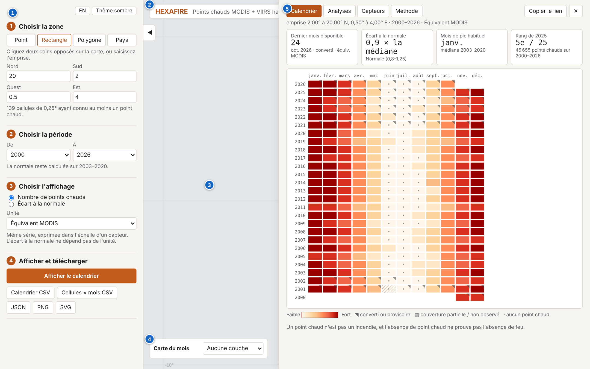

| N° | Élément | Rôle |
|---|---|---|
| 1 | **Panneau de recherche** (à gauche) | Les 4 étapes de la recherche : zone, période, affichage, téléchargement. Le bouton ◀ le replie pour agrandir la carte. |
| 2 | **En-tête** | Nom de l'application. Le bandeau jaune signale les données d'exemple. |
| 3 | **Carte** | Fond OpenStreetMap ; la zone choisie y est tracée en orange. |
| 4 | **Carte du mois** | Affiche sur la carte les points chauds ou l'écart à la normale d'un mois donné (section 5). |
| 5 | **Panneau de résultats** (à droite) | S'ouvre après « Afficher le calendrier » ; 4 onglets (sections 6 à 9). Le bouton ✕ le ferme. |

La même vue, en réel, avec une zone rectangulaire sur le Bénin, le Niger et le Burkina Faso :

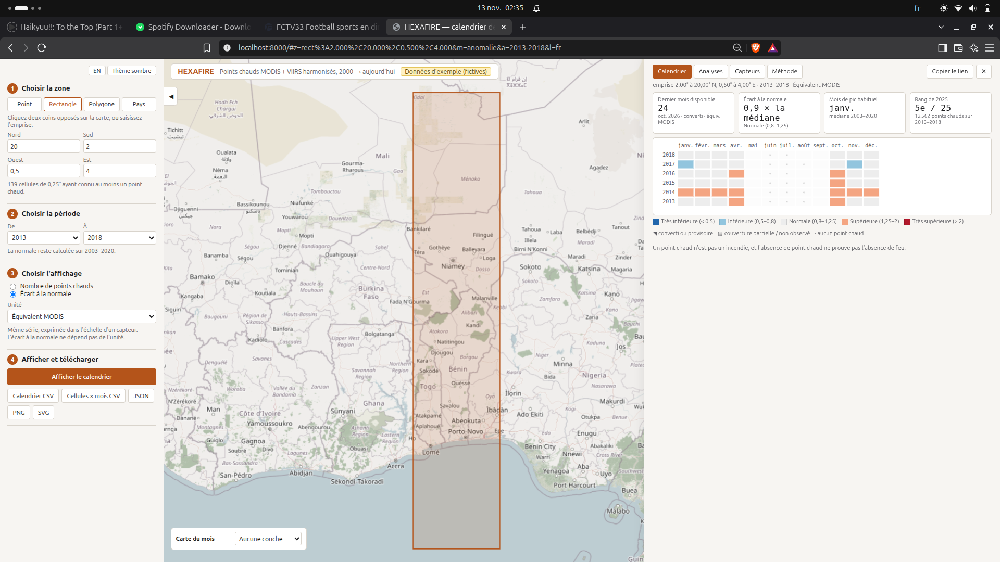

**Parcours type (3 minutes)** :

1. tracer sa zone ;
2. choisir la période ;
3. cliquer sur *Afficher le calendrier* ;
4. passer en « Écart à la normale » ;
5. survoler une case pour lire sa valeur ;
6. ouvrir l'onglet *Capteurs* pour voir la preuve de l'harmonisation ;
7. télécharger le CSV.

# 3. Étape 1 — Choisir la zone

Quatre façons de définir une zone, par les onglets en haut de l'étape.

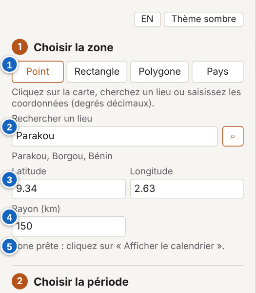{width=45%}

| N° | Élément | Comment s'en servir |
|---|---|---|
| 1 | **Onglets de zone** | *Point*, *Rectangle*, *Polygone* ou *Pays*. |
| 2 | **Rechercher un lieu** | Tapez un nom (ville, région) puis ⌕ ou Entrée. Le lieu trouvé s'affiche dessous et ses coordonnées remplissent les champs. |
| 3 | **Latitude, longitude** | En degrés décimaux. Latitude positive au nord, longitude positive à l'est. Un clic sur la carte les remplit aussi. |
| 4 | **Rayon** | Entre 15 et 2 000 km autour du point. |
| 5 | **Message d'état** | « Zone prête » ; après calcul, le nombre de cellules de 0,25° de la zone ayant connu au moins un point chaud. |

**Rectangle** : deux clics sur la carte, sur deux coins opposés, ou saisie des limites nord, sud, ouest et est.

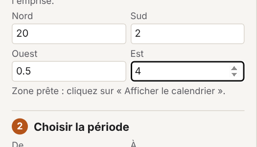{width=45%}

**Polygone** : cliquez chaque sommet sur la carte, puis **double-cliquez** pour fermer la forme. Le nombre de sommets
s'affiche pendant le tracé.

**Pays** : choisissez un pays dans la liste. Il faut pour cela le fichier des frontières `donnees/pays.geojson` (voir le
README de l'application). S'il manque, un message l'indique.

**Comment la zone est utilisée.** Les données sont rangées dans une grille de **cellules de 0,25°** (environ 28 km à
l'équateur). Une cellule compte dans la zone si **son centre** est à l'intérieur. Une zone plus petite qu'une cellule
peut donc ne contenir aucune cellule : agrandissez-la.

# 4. Étapes 2, 3 et 4 — Période, affichage, téléchargement

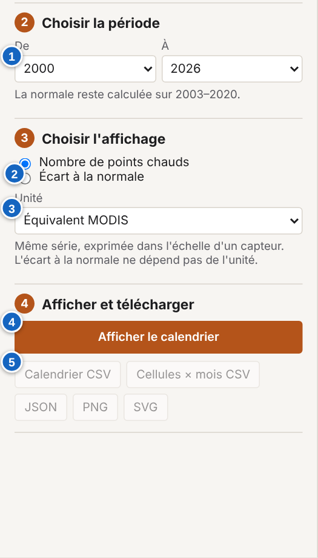{width=38%}

| N° | Élément | Signification |
|---|---|---|
| 1 | **Période** (De / À) | Années affichées dans le calendrier et prises en compte dans les indicateurs. La **normale reste toujours calculée sur 2003–2020**, quelle que soit la période choisie. |
| 2 | **Grandeur affichée** | *Nombre de points chauds* : couleur selon l'activité du mois. *Écart à la normale* : couleur selon la comparaison avec le même mois les années habituelles (section 6.3). |
| 3 | **Unité** | *Équivalent MODIS* : ce que les satellites Terra et Aqua auraient détecté. *Équivalent VIIRS (S-NPP)* : ce que le satellite S-NPP seul aurait détecté. C'est la **même série** à une autre échelle (les valeurs VIIRS sont plus grandes, VIIRS voyant plus de petits feux). L'écart à la normale ne change pratiquement pas. |
| 4 | **Afficher le calendrier** | Lance le calcul et ouvre le panneau de résultats. |
| 5 | **Téléchargements** | Actifs après le calcul (section 10). |

# 5. La carte du mois

En bas à gauche de la carte, la boîte **Carte du mois** colore le monde par cases de **1°** (environ 110 km) pour un
mois donné. C'est l'équivalent de la fonction *Visualize* de NASA POWER.

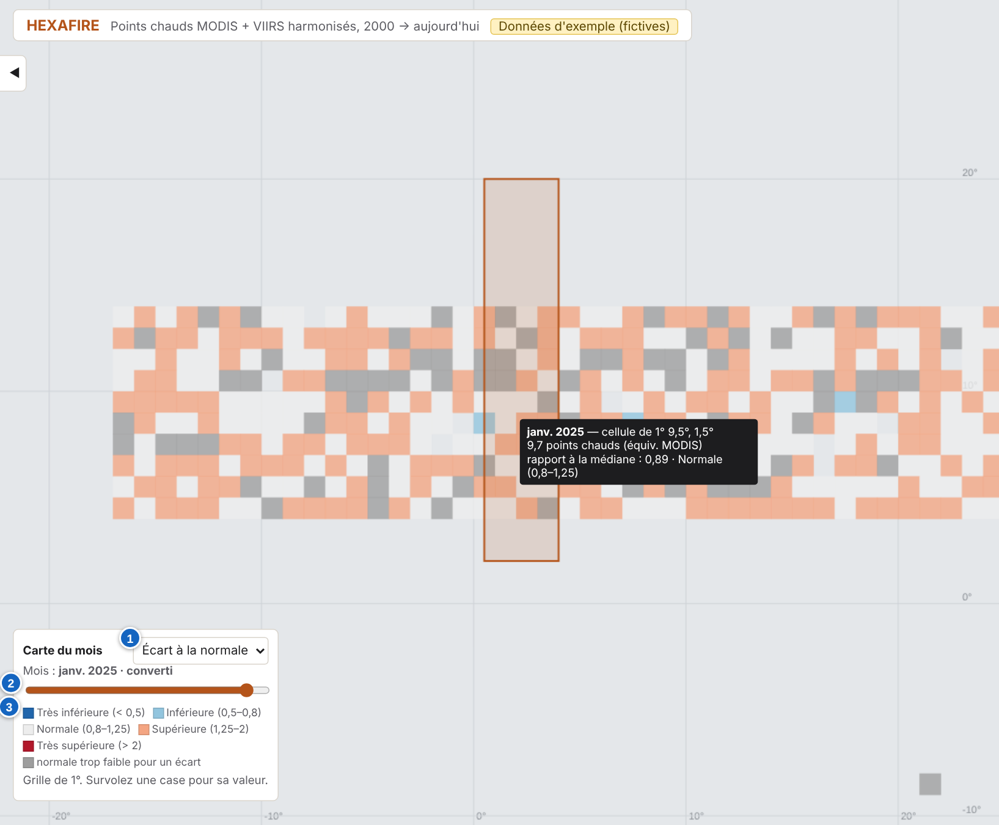{width=80%}

| N° | Élément | Signification |
|---|---|---|
| 1 | **Couche** | *Aucune couche*, *Points chauds* (niveau d'activité) ou *Écart à la normale*. |
| 2 | **Curseur des mois** | Glisser pour changer de mois. Le mois et son statut (mesuré, converti…) s'affichent au-dessus. Seuls les mois observés sont proposés. |
| 3 | **Légende** | Les couleurs de la couche choisie. |

**Lire la couche « Écart à la normale »** : chaque case compare le mois choisi à la **médiane du même mois sur
2003–2020** pour cette case (classes en section 6.3).
- **Gris** : la normale de la case est trop faible pour calculer un écart (médiane < 5 points chauds, ou moins de 10 années de référence).
- **Case absente** : aucun point chaud, et normale faible.
- Une case **bleue** est donc une région habituellement active qui l'a été beaucoup moins ce mois-là.

**Infobulle** : en survolant une case, on lit le mois, la position de la case, sa valeur (dans l'unité choisie à
l'étape 3) et son rapport à la médiane.

**Couche « Points chauds »** : couleur de plus en plus foncée avec l'activité, sur une échelle logarithmique. Le
maximum du mois est indiqué dans la légende.

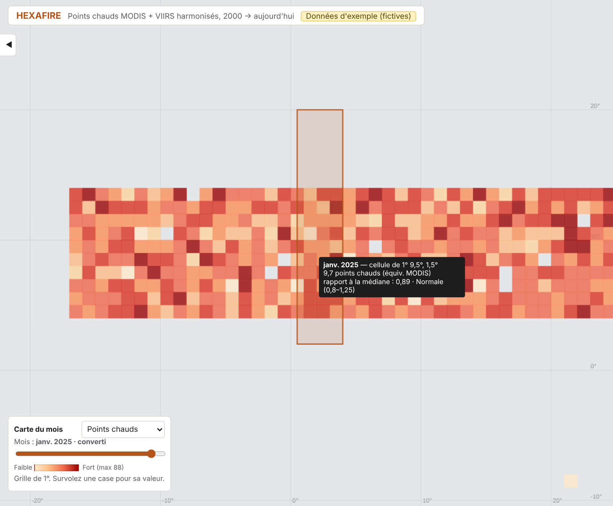{width=80%}

# 6. Onglet Calendrier

C'est l'écran principal : **une ligne par année** (la plus récente en haut) et **une colonne par mois**.

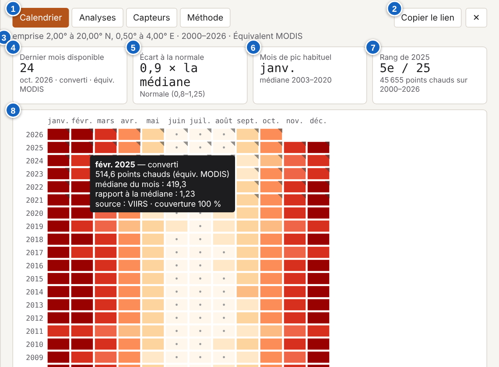{width=85%}

## 6.1 Barre du haut

| N° | Élément | Rôle |
|---|---|---|
| 1 | **Onglets** | Calendrier, Analyses, Capteurs, Méthode. |
| 2 | **Copier le lien** | Copie une adresse qui contient la zone, la période, la grandeur, l'unité et la langue. En l'ouvrant, un collègue retrouve exactement la même recherche (section 11). |
| 3 | **Titre** | Rappel de la zone, de la période et de l'unité. |

## 6.2 Les quatre indicateurs

| N° | Indicateur | Ce qu'il dit |
|---|---|---|
| 4 | **Dernier mois disponible** | Valeur du mois le plus récent de la série, avec son mois, son statut et l'unité. |
| 5 | **Écart à la normale** | Ce même mois comparé à la médiane du même mois sur 2003–2020 (« 0,9 × la médiane » = 10 % sous la normale), avec sa classe. S'il ne peut pas être calculé, la raison est donnée (section 6.4). |
| 6 | **Mois de pic habituel** | Mois où la médiane 2003–2020 est la plus haute : le cœur de la saison des feux de la zone. |
| 7 | **Rang de l'année** | Dernière année **complète** de la période choisie, classée parmi toutes les années complètes (1re = la plus active). Dessous : total des points chauds sur la période. |

## 6.3 La grille (n° 8) et ses couleurs

**En mode « Nombre de points chauds »** : rampe du crème (faible) au rouge foncé (fort), sur une échelle
**logarithmique**. Les mois faibles restent ainsi distincts même quand la saison des feux écrase les valeurs. Le
rouge le plus foncé correspond au mois le plus actif de la période affichée.

**En mode « Écart à la normale »** : chaque case est comparée à la **médiane du même mois sur 2003–2020**.

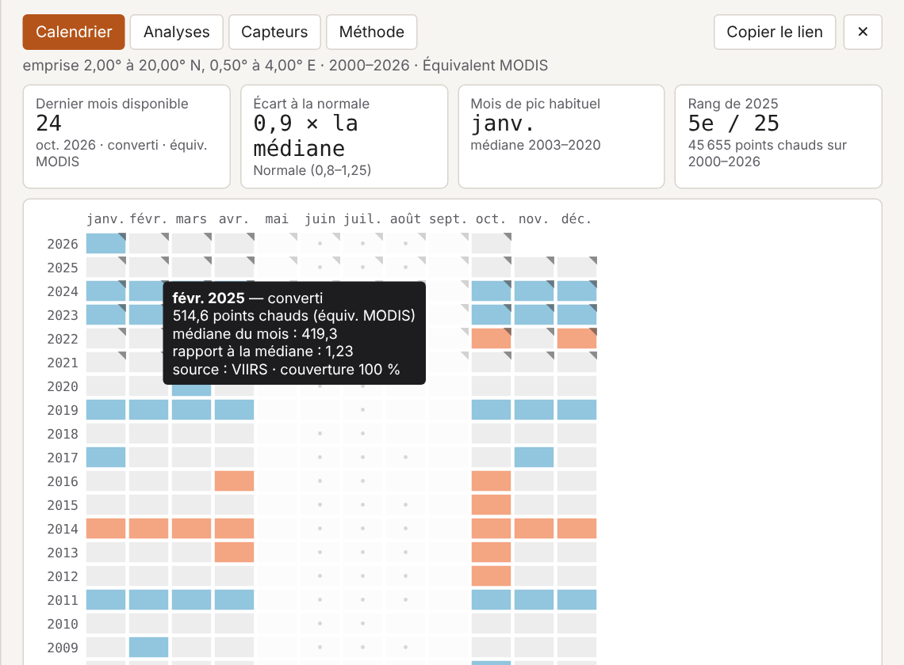{width=85%}

| Couleur | Classe | Rapport à la médiane |
|---|---|---|
| Bleu foncé | Très inférieure | < 0,5 (moins de la moitié de la normale) |
| Bleu clair | Inférieure | 0,5 à 0,8 |
| Gris très clair | Normale | 0,8 à 1,25 |
| Orange clair | Supérieure | 1,25 à 2 |
| Rouge | Très supérieure | > 2 (plus du double) |

Ces couleurs (rampe rouge-bleu) restent lisibles pour les formes courantes de daltonisme. Le **statut** d'un mois est
aussi indiqué par une texture, jamais par la couleur seule :

| Marque | Signification |
|---|---|
| ◥ petit triangle gris (coin haut droit) | Mois **converti** (VIIRS depuis 2021, ou Terra seul en 2000–2002, ramené en équivalent MODIS) ou **provisoire** |
| ▨ hachures | **Couverture partielle** (le satellite a manqué des jours) ou **non observé** (case vide en pointillés) |
| · point gris au centre | **Aucun point chaud** ce mois-là |
| voile blanc (mode écart) | Écart **non calculable** pour ce mois (section 6.4) |

## 6.4 Les statuts d'un mois

| Statut | Sens |
|---|---|
| **mesuré** | Mesuré par MODIS Terra + Aqua (juillet 2002 – décembre 2020). |
| **converti** | Valeur ramenée sur l'échelle Terra + Aqua par un facteur appris : VIIRS (S-NPP, NOAA-20, NOAA-21) à partir de janvier 2021, et aussi Terra seul de novembre 2000 à juin 2002, avant le lancement d'Aqua. |
| **provisoire** | Mois récent encore rempli par MODIS en attendant les données VIIRS. |
| **couverture partielle** | Le satellite a manqué 20 % à 70 % des jours du mois. La valeur est corrigée, mais plus incertaine. |
| **non observé** | Plus de 70 % des jours manquent : pas de valeur. |

L'écart à la normale est **refusé** dans deux cas, indiqués dans l'infobulle et l'indicateur :
- **référence insuffisante** : moins de 10 années de 2003–2020 disponibles pour ce mois ;
- **effectif trop faible** : la médiane du mois est inférieure à 5 points chauds (en équivalent MODIS). Avec si peu de
  détections, un rapport n'a pas de sens : 3 points chauds au lieu de 1 donnerait « × 3 ».

Ce second cas est fréquent **hors saison des feux** : sur les captures, les mois de mai à septembre de la zone d'exemple
sont voilés pour cette raison.

## 6.5 L'infobulle

Survoler une case affiche :
- le mois et son statut ;
- la valeur et l'unité ;
- la médiane du même mois sur 2003–2020 ;
- le rapport à cette médiane (ou la raison du refus) ;
- la source (MODIS, VIIRS…) et la couverture du mois (part des jours réellement observés).

## 6.6 La légende (n° 9)

Elle rappelle la rampe ou les classes du mode choisi et la signification des textures.

# 7. Onglet Analyses

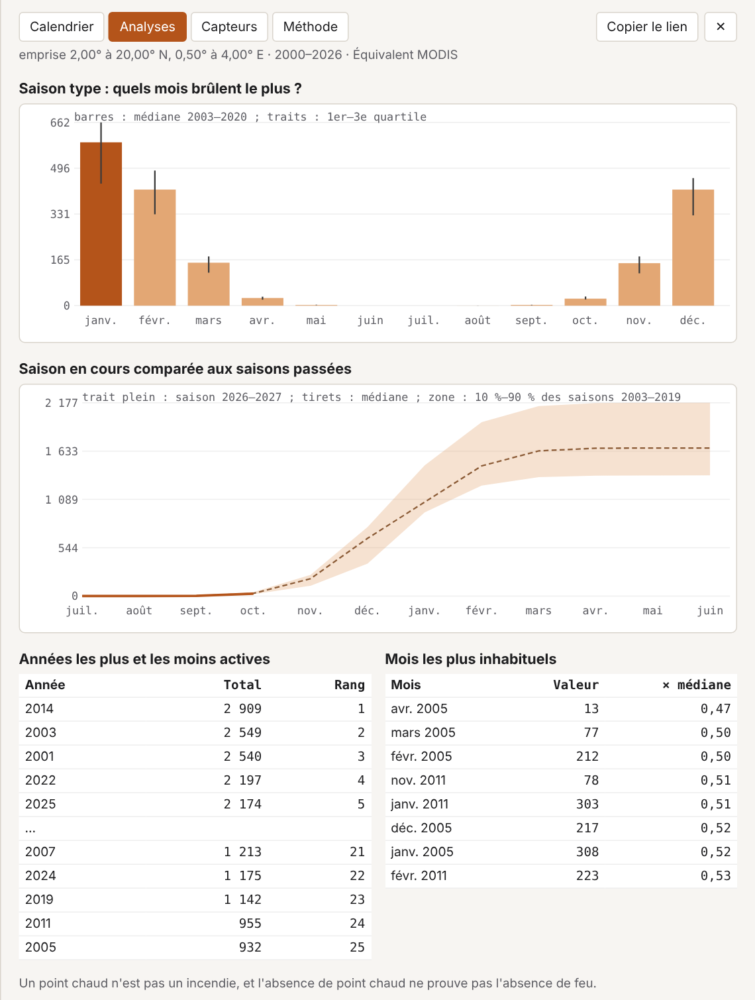{width=70%}

**Saison type : quels mois brûlent le plus ?**
- Une barre par mois : la **médiane 2003–2020**. La barre la plus foncée marque le mois de pic.
- Le trait vertical va du 1er au 3e quartile : la moitié des années se situe dans cette plage. Un long trait signale un mois très variable d'une année à l'autre.

**Saison en cours comparée aux saisons passées.**
- Cumul des points chauds depuis le début de la saison. La saison commence le mois qui suit le mois habituellement le plus calme de la zone, de sorte qu'une saison sèche à cheval sur deux années n'est pas coupée en deux.
- **Trait plein** : la saison en cours. **Tirets** : la saison médiane. **Zone colorée** : 80 % des saisons 2003–2019 (de 10 % à 90 %).
- Un trait plein au-dessus de la zone colorée signale une saison plus active que presque toutes les saisons passées, à ce stade de l'année.

**Années les plus et les moins actives.** Les 5 années complètes les plus actives et les 5 moins actives, avec leur
total et leur rang.

**Mois les plus inhabituels.** Les 8 mois les plus éloignés de leur normale, vers le haut **ou** vers le bas
(colonne « × médiane » : 0,47 = moins de la moitié de la normale ; 2,3 = plus du double).

# 8. Onglet Capteurs — la preuve de l'harmonisation

Cet onglet répond à la question du défi : la série harmonisée est-elle fiable au changement de satellite ?

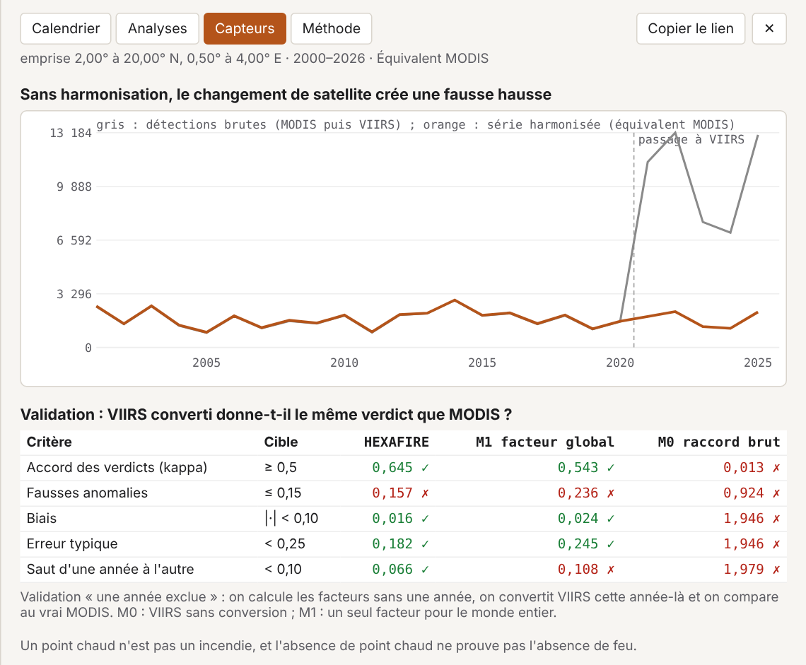{width=85%}

**Graphique « Sans harmonisation, le changement de satellite crée une fausse hausse »** : total annuel de la zone.

- **Gris** : détections **brutes**, c'est-à-dire ce que donne le satellite utilisé chaque année (MODIS jusqu'en 2020, VIIRS ensuite).
- **Orange** : série **harmonisée** (équivalent MODIS).
- **Tirets verticaux** : passage à VIIRS (janvier 2021).

**Lecture** : à partir de 2021, la courbe grise **saute** (VIIRS détecte 5 à 15 fois plus de points chauds), alors
que la courbe orange **continue sans rupture**. Sans harmonisation, on croirait à une explosion des feux qui
n'a pas eu lieu.

**Tableau de validation.** Test « une année exclue » :
1. on calcule les facteurs de conversion sans une année de 2012–2020 ;
2. on convertit VIIRS cette année-là comme si MODIS n'existait plus ;
3. on compare au vrai MODIS, mois par mois et région par région.

Trois méthodes sont comparées : **HEXAFIRE** (notre méthode), **M1** (un seul facteur pour le monde entier) et
**M0** (VIIRS sans conversion). Une coche verte ✓ signale une cible atteinte, une croix rouge ✗ une cible manquée.

| Critère | Cible | Sens |
|---|---|---|
| Accord des verdicts (kappa) | ≥ 0,5 | Le mois est-il jugé bas, normal ou haut comme avec MODIS ? (0 = hasard, 1 = toujours d'accord) |
| Fausses anomalies | ≤ 0,15 | Part des mois normaux pour MODIS que la méthode déclarerait anormaux |
| Biais | \|·\| < 0,10 | Surestimation (> 0) ou sous-estimation (< 0) systématique |
| Erreur typique | < 0,25 | Écart habituel d'un mois (0,13 ≈ 13 %) |
| Saut d'une année à l'autre | < 0,10 | Plus grand décalage moyen d'une année : mesure la « fausse marche » |

Résultats réels sur les données déjà téléchargées (13 novembre 2026) :

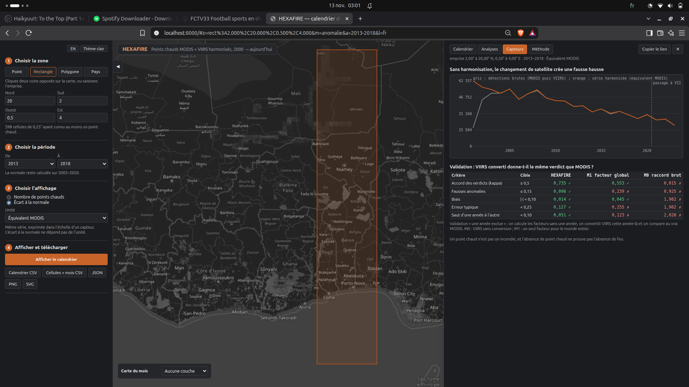

HEXAFIRE atteint les **5 cibles** (kappa 0,735 ; fausses anomalies 0,098). M1 en manque 3 ; M0 les manque toutes.

> Sur cette capture réelle, les courbes grise et orange se superposent encore après 2021 : les mois récents sont
> « provisoires » (remplis par MODIS) tant que les données VIIRS 2021+ ne sont pas préparées. Le saut de la courbe
> grise apparaîtra ensuite.

# 9. Onglet Méthode

Fiches courtes en langage simple :
- ce qu'est un point chaud ;
- pourquoi harmoniser MODIS et VIIRS, et comment ;
- les deux unités ;
- comment on vérifie que ça marche ;
- la définition de l'écart à la normale ;
- les sources des données et les remerciements : provenance des archives, remerciement demandé par NASA FIRMS,
  références scientifiques, crédits OpenStreetMap et Natural Earth. Le détail complet est dans le fichier
  `DATA_SOURCES.md` du dépôt.

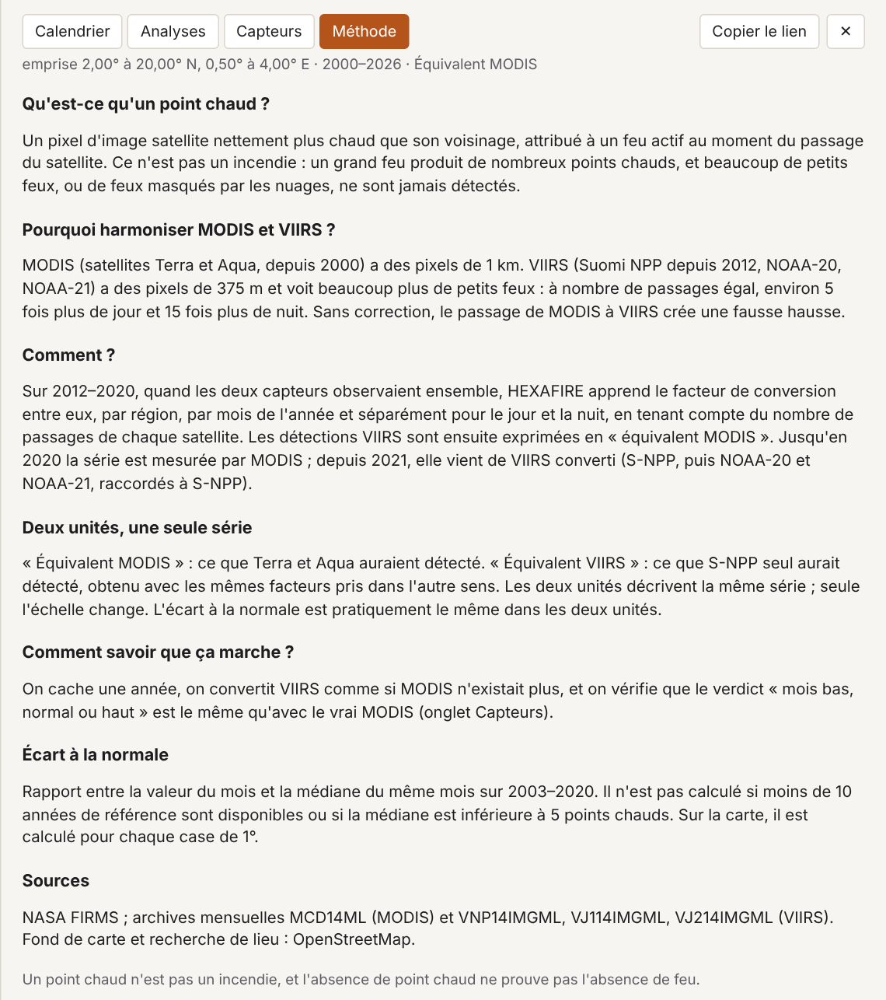{width=75%}

# 10. Téléchargements

Les boutons de l'étape 4 deviennent actifs après le calcul.

| Bouton | Fichier | Contenu |
|---|---|---|
| **Calendrier CSV** | `hexafire_calendrier_<unité>.csv` | Une ligne par mois (colonnes ci-dessous). |
| **Cellules × mois CSV** | `hexafire_cellules_mois.csv` | Le détail : une ligne par cellule de 0,25° et par mois actif. Colonnes : cellule, position du centre, année, mois, valeur équivalent MODIS, valeur équivalent VIIRS, détections brutes, source. |
| **JSON** | `hexafire_calendrier_<unité>.json` | Même contenu que le CSV du calendrier, pour un programme. |
| **PNG / SVG** | `hexafire_calendrier.png` / `.svg` | Image du calendrier affiché (mode et période en cours). Le SVG reste net à toute taille, pour un rapport. |

Colonnes du CSV du calendrier :

| Colonne | Contenu |
|---|---|
| `annee`, `mois` | Le mois |
| `valeur` | Valeur dans l'unité choisie |
| `statut`, `source`, `couverture` | Voir section 6.4 |
| `mediane_mois` | Médiane du même mois sur 2003–2020 |
| `rapport_mediane` | Rapport à cette médiane |
| `classe` | `tres_inf`, `inf`, `normale`, `sup`, `tres_sup`, ou la raison du refus (`ref_insuffisante`, `effectif_faible`) |

Chaque CSV commence par des lignes `#` de **provenance** : unité, zone exacte, période de référence, date des
données, avertissement et remerciement NASA FIRMS (à conserver si vous rediffusez les données). Elles se lisent avec n'importe quel tableur (ignorer les lignes commençant par `#`).

# 11. Outils : langue, thème, lien partagé, téléphone

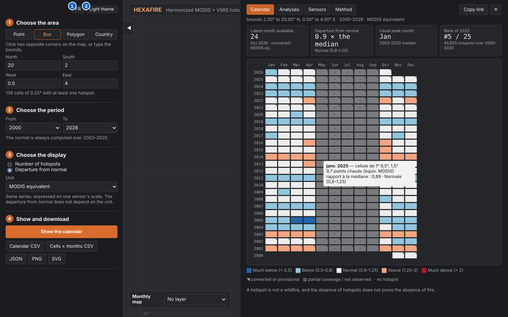

| N° | Outil | Rôle |
|---|---|---|
| 1 | **EN / FR** | Passe toute l'interface en anglais ou en français. Le choix est mémorisé par le navigateur et inclus dans le lien partagé. |
| 2 | **Thème sombre / clair** | Change les couleurs de l'interface et du fond de carte. Par défaut, l'application suit le réglage de l'ordinateur. |

**Lien partagé.** L'adresse de la page contient la recherche, par exemple
`#z=rect:2,20,0.5,4&m=anomalie&a=2013-2018&u=viirs&l=fr`. En l'ouvrant, on retrouve la même zone, le même mode, la même
période, la même unité et la même langue, et le calendrier se calcule automatiquement.

| Paramètre | Contenu |
|---|---|
| `z` | zone : `cercle:lat,lon,rayon`, `rect:sud,nord,ouest,est`, `pays:CODE` ou `poly:lon lat;...` |
| `m` | mode : `niveau` ou `anomalie` |
| `a` | période : `début-fin` |
| `u` | unité (`viirs` si choisie) |
| `l` | langue |

**Sur téléphone**, les éléments s'empilent : carte, puis panneau, puis résultats. Le calendrier défile horizontalement.

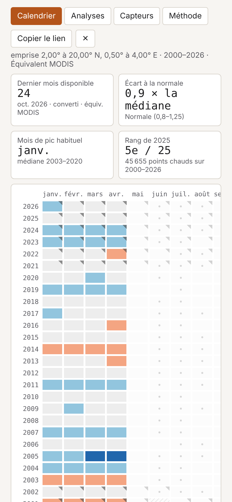{width=38%}

# 12. Questions fréquentes

**Pourquoi l'écart à la normale est-il vide pour certains mois ?** La normale de ce mois est inférieure à 5 points chauds
(souvent hors saison des feux) ou il y a moins de 10 années de référence. Voir la section 6.4.

**Pourquoi « Équivalent VIIRS » donne-t-il des nombres beaucoup plus grands ?** VIIRS a des pixels plus fins (375 m contre
1 km) et voit beaucoup plus de petits feux, surtout la nuit. Ce sont les mêmes mois, sur une autre échelle. Comparer
deux zones ou deux années n'a de sens que **dans la même unité**.

**Puis-je additionner les valeurs pour estimer une surface brûlée ou un nombre d'incendies ?** Non. Un point chaud est
une détection ponctuelle au moment du passage du satellite. HEXAFIRE sert à repérer **un écart par rapport à
l'historique**, pas à mesurer des surfaces.

**Pourquoi le nombre de cellules annoncé est-il petit pour une grande zone ?** Seules les cellules ayant connu **au moins un
point chaud** sur toute la période sont comptées. Les déserts et les océans n'en ont pas.

**Les valeurs sont-elles des nombres entiers ?** Non. Une valeur harmonisée est corrigée du nombre de passages du satellite
et, à partir de 2021, convertie depuis VIIRS : elle peut donc avoir des décimales.

**L'application est-elle utilisable sans Internet ?** Oui, sauf la carte, la recherche de lieu et la liste des pays si
`pays.geojson` est absent : on saisit alors les coordonnées.
